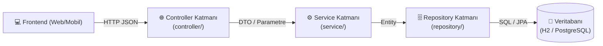

# 🏛️ SmartCommerce REST API — Mimari Tasarım Belgesi (`ARCHITECTURE.md`)

Bu belge, projemizin **katmanlı mimarisini (Layered Architecture)** ve veri akış kurallarını tanımlar. Kod yazarken kullandığım AI kodlama ajanı (Claude Code) bu belgedeki kurallara uymak zorundadır; `AGENTS.md` buraya atıf yapar.

---

## 1. Sistemin Amacı ve Çalışma Prensibi

* Bu sistem, Frontend uygulamasının doğrudan HTTP/JSON istekleri attığı **%100 standart bir Java 21 + Spring Boot 3 REST API** projesidir.
* **Çalışma zamanında (Runtime) API'nin içinde AI yoktur.**
* **AI'ın Rolü (Geliştirme Zamanı / Dev-Time):** Ben (yazılımcı) kod geliştirirken; DTO dönüşümleri, Controller endpoint iskeletleri, Validation anotasyonları, Exception Handling ve JUnit 5 birim testleri gibi **amelasyon (boilerplate)** işlerini ve standart kuralları benim yerime hazırlayan bir **AI kodlama ajanıdır** (Claude Code + repo içindeki `AGENTS.md`, skill ve hook dosyaları).

---

## 2. Katmanlı Mimari (Layered Architecture)

### Katman Sorumlulukları:
1. **`domain/` (Entity Katmanı):**
   * Veritabanı tablolarını temsil eden JPA `@Entity` sınıfları (şu an: `Product`).
   * İçinde iş mantığı (business logic) veya HTTP/JSON bağımlılığı barındırmaz.
2. **`repository/` (Veri Erişim Katmanı):**
   * `JpaRepository<Entity, ID>` arayüzleri (şu an: `ProductRepository`).
   * Sadece veritabanı sorgularından sorumludur.
3. **`service/` (İş Mantığı Katmanı - Yazılımcının Ana Alanı):**
   * `ProductService`, `AuthService`.
   * Tüm iş kuralları, doğrulamalar ve `@Transactional` veritabanı bütünlüğü burada yaşar.
   * Başka servise HTTP çağrısı transaction içinde yapılmaz.
4. **`dto/` (Veri Transfer Nesneleri - AI Amelasyon Alanı):**
   * Request ve Response modelleri Java `record` olarak burada tanımlanır. Controller `@Entity` dönmez.
5. **`controller/` (Sunum / REST API Katmanı - AI Amelasyon Alanı):**
   * Frontend'in konuştuğu `@RestController` sınıfları (`ProductController`, `AuthController`).
   * İş kuralı içermez; sadece HTTP isteğini karşılar, `Service` katmanını çağırır ve `ResponseEntity` döner.
6. **`client/` (Dış Servis İstemcileri):**
   * Başka mikroservise giden `RestClient` sarmalayıcıları (`AuthClient`). Sadece service katmanından çağrılır; path ve alanlar `CONTRACTS.md` ile aynı olmalıdır.
