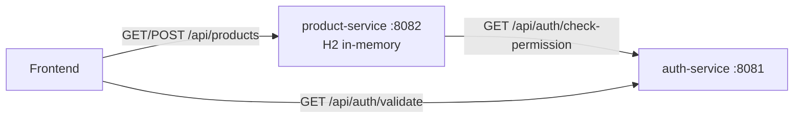
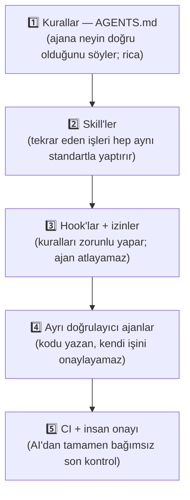

# 🛒 SmartCommerce — AI Engineering Öğrenme Laboratuvarım

Merhaba! Ben bir **.NET geliştiricisiyim** ve **AI Engineering** alanına sıfırdan giriyorum. Bu repo, o yolculukta kurduğum öğrenme laboratuvarı. Burada iki şeyi aynı anda öğreniyorum:

1. **Java 21 + Spring Boot 3 ile mikroservis geliştirmek** (.NET bilgimi Java'ya taşıyarak)
2. **AI kodlama ajanlarıyla profesyonel şekilde çalışmak**: ajana kural vermek, sınır koymak, yaptığı işi ajanın sözüne güvenmeden doğrulamak

> ⚠️ Bu bilerek basit tutulmuş bir öğrenme projesi. Token'lar sabit kodlu, veritabanı bellek içi (H2). Odak noktam uygulamanın karmaşıklığı değil, **AI ile nasıl doğru çalışıldığını** öğrenmek.

---

## 📌 İçindekiler

1. [Proje: iki mikroservis](#-proje-iki-mikroservis)
2. [AI ile nasıl geliştiriyorum?](#-ai-ile-nasıl-geliştiriyorum)
3. [Hook'lar ne işe yarıyor?](#-hooklar-ne-işe-yarıyor)
4. [Yolda yaptığım hatalar ve öğrendiklerim](#-yolda-yaptığım-hatalar-ve-öğrendiklerim)
5. [Notlarım: .NET'ten Java'ya](#-notlarım-netten-javaya)
6. [Notlarım: AI & LLM terimleri](#-notlarım-ai--llm-terimleri)
7. [Kendime sorduğum sorular](#-kendime-sorduğum-sorular)
8. [Yol haritam](#-yol-haritam)

---

## 🧩 Proje: iki mikroservis

* **auth-service (8081):** Token doğrulama ve rol → izin kontrolü
* **product-service (8082):** Ürün kataloğu. Ürün eklerken kullanıcının yetkisini auth-service'e soruyor.



İki servis ayrı Maven modülü, birbirinin kodunu import etmiyor, sadece HTTP ile konuşuyor (`RestClient`). Çalışma zamanında servislerin içinde AI yok; AI'ı **geliştirme sırasında** kullanıyorum.

* Servisler arası kontrat: [CONTRACTS.md](CONTRACTS.md)
* Katman kuralları: [ARCHITECTURE.md](ARCHITECTURE.md)

### Çalıştırma

Gereksinimler: JDK 21, Maven 3.9+

```bash
brew install openjdk@21 maven
```

İki ayrı terminalde:

```bash
mvn -pl auth-service spring-boot:run
```

```bash
mvn -pl product-service spring-boot:run
```

Testler:

```bash
mvn test
```

### API

| Test token'ı | Rol | İzinler |
| :--- | :--- | :--- |
| `admin-token` | ADMIN | `PRODUCT_READ`, `PRODUCT_WRITE` |
| `seller-token` | SELLER | `PRODUCT_READ` |

```bash
curl http://localhost:8082/api/products
```

```bash
curl -X POST http://localhost:8082/api/products -H "X-Auth-Token: admin-token" -H "Content-Type: application/json" -d '{"name":"Klavye","category":"Aksesuar","price":1500.00,"stockQuantity":10}'
```

```bash
curl "http://localhost:8081/api/auth/validate?token=seller-token"
```

---

## 🤖 AI ile nasıl geliştiriyorum?

Kodu **Claude Code** ile yazıyorum. Ama ajana "şunu yaz" deyip çıkanı kabul etmiyorum. Öğrendiğim en önemli şey şu oldu:

> **AI'a yazılı kural vermek bir ricadır. Profesyonel düzen, o kuralı ajan unutsa bile işleyen kontroller kurmaktır.**

Bu yüzden kontrolü katman katman kurdum. Bir katman kaçırırsa üstteki yakalıyor:



### Repodaki AI dosyaları

| Dosya | Ne işe yarıyor |
| :--- | :--- |
| [AGENTS.md](AGENTS.md) | Ajanın her oturumda okuduğu kurallar: komutlar, kod standartları, servis sınırları, "bitti" tanımı |
| `auth-service/AGENTS.md`, `product-service/AGENTS.md` | Servise özel bilgiler; ajan o klasörde çalışırken yüklenir |
| `.claude/agents/code-reviewer.md` | Bağımsız kod inceleyici. **Dosya değiştiremez**, sadece `ONAY` / `RED` raporu yazar |
| `.claude/agents/test-engineer.md` | Testleri yazar. **Sadece test klasörüne** yazabilir |
| `.claude/skills/` | Talimat paketleri: `add-permission`, `boilerplate-generator`, `db-changes`, `ci-build`, `junit-test-generator`, `architecture-guard` |
| `.claude/settings.json` | İzinler ve hook tanımları |
| `.claude/hooks/` | Hook script'leri (aşağıda tek tek anlattım) |
| `.github/workflows/ci.yml` | Her branch'teki her push'ta ve her PR'da `mvn -B verify` |
| `.github/workflows/claude-review.yml` | Her PR'da `code-reviewer` kurallarıyla AI incelemesi |

### Bir özellik nasıl geliştiriliyor?

Her değişiklik için aynı ağır süreci çalıştırmıyorum; **riske göre** seçiyorum:

| Değişiklik | Örnek | Akış |
| :--- | :--- | :--- |
| **Küçük** | yazım hatası, yorum, doküman | Değişiklik → test kapısı (otomatik) |
| **Normal** | yeni endpoint, iş kuralı, bug fix | Kod → `test-engineer` → `code-reviewer` |
| **Riskli** | yetki, servisler arası kontrat, DB şeması | Normal akış + `/security-review` + `mvn -B verify` |

---

## 🪝 Hook'lar ne işe yarıyor?

### Önce: hook nedir?

**Hook**, AI ajanı belirli bir şey yaptığında **otomatik çalışan küçük bir script**. Ajan bir dosya yazmadan önce, yazdıktan sonra ya da "bitti" demeden önce devreye giriyor.

.NET'ten bildiğim karşılıkları:
* **Middleware / Action Filter:** İstek controller'a gelmeden araya girip "bu isteğe izin var mı?" diye bakması gibi.
* **Git pre-commit hook:** Commit'ten önce otomatik test çalıştırması gibi.

### Neden önemli? (benim için en büyük "aha" anı)

| | `AGENTS.md`'ye kural yazmak | Hook yazmak |
| :--- | :--- | :--- |
| Çalışma şekli | Ajan okur ve **uymaya çalışır** | Script çalışır ve **izin vermez** |
| Ajan unutursa / yanlış anlarsa | Kural ihlal edilir | Fark etmez, yine engellenir |
| Benzetme | Duvardaki "girilmez" tabelası | Kilitli kapı |

Yani `AGENTS.md`'ye "testlere dokunma" yazmak bir rica. Hook ise o kuralı **zorunlu** yapıyor.

### Bu projedeki hook'lar

#### 1. `agent-scope.sh` + `test-guard.sh` — Testlere kim dokunabilir?

Hedefim şu sınırlar:

| Kim | Yazabildiği yer |
| :--- | :--- |
| Ana ajan (kodu yazan) | Her yer, **testler hariç** |
| `test-engineer` | **Sadece** `src/test/**` |
| `code-reviewer` | **Hiçbir yer** (salt okunur) |

**Neden?** Kodu yazan ajan testlere de dokunabilseydi, test kırmızı olduğunda kodu düzeltmek yerine testi gevşetip "testler geçti" diyebilirdi. Bu, ekiplerdeki **"dört göz" prensibi**: kodu yazan, kendi kodunu onaylamaz.

Bunu iki katmanla uyguluyorum, çünkü tek katman yetmiyor:

* **Önleme — `agent-scope.sh` (PreToolUse, işlemden önce):** Write/Edit ile test dosyasına yazmayı engelliyor. Bash komutlarını da metin olarak inceliyor: `sed -i`, `>`, `tee`, `cp` gibi yazma kalıpları test dosyalarıyla birlikte geçiyorsa engelliyor.
* **Tespit — `test-guard.sh` (PostToolUse, her işlemden sonra):** Bash komutunu metin olarak incelemek her yolu kapatamaz; örneğin ajan testi bir script dosyası üzerinden değiştirebilir. Bu yüzden her işlemden sonra test dosyalarının **parmak izini (hash)** alıyorum. `test-engineer` dışında biri testleri herhangi bir yolla değiştirirse bu yakalanıyor, ajana bildiriliyor ve test kapısı bu düzelene kadar işin bitmesine izin vermiyor.

Yani dürüst özet: Ana ajanın testi değiştirmesinin **yaygın yollarını önlüyorum**, kaçanları ise **sonradan tespit edip işi bitirmesine izin vermiyorum**.

Engellenen her girişim `.claude/state/hook.log` dosyasına yazılıyor. Gerçek bir oturumda denediğimde kayıt şöyleydi:

```
DENY agent=main tool=Write path=product-service/src/test/java/HookProbeMain.java
DENY agent=general-purpose tool=Write path=product-service/src/test/java/HookProbeSub.java
```

#### 2. `mark-changed.sh` + `test-gate.sh` — Test kapısı (ajan "bitti" demeden **önce**)

* `mark-changed.sh` (PostToolUse): Her işlemden sonra auth ve product modüllerinin parmak izine bakıp hangisinin değiştiğini not alıyor. Parmak izine baktığı için değişiklik Write ile de yapılsa, Bash ile de yapılsa yakalanıyor. Oturum başındaki referansı `snapshot.sh` (SessionStart) alıyor.
* `test-gate.sh` (Stop): Ajan işi bitirmeye çalıştığında devreye giriyor:
  * Testler test-engineer dışında değiştirildiyse → **engelliyor**.
  * Kod değiştiyse değişen modülün testlerini **kendisi çalıştırıyor**. Yeşilse ajan bitirebilir; kırmızıysa **engelliyor** ve hatayı ajana geri veriyor.
  * Sadece doküman değiştiyse → test çalıştırmıyor.

**Bilinçli sınırları:** Sonsuz döngüye girmesin diye **en fazla 3 kez art arda engelliyor**, sonra ajanın durmasına izin veriyor ama bana "iş bitmiş sayılmaz" uyarısı gösteriyor. Makinede JDK/Maven yoksa testleri çalıştıramıyor; engellemiyor, "doğrulanmadı" uyarısı gösteriyor. Yani test kapısı ajanı sonsuza kadar kilitlemiyor, ama "bitti" demesinin bedava olmasını engelliyor ve sonucu bana açıkça söylüyor.

**Neden ekledim?** Eskiden "testler geçti" diyen ajanın kendisiydi. Şimdi bunu bir script kontrol ediyor.

#### 3. `contract-reminder.sh` — Kontrat hatırlatıcısı (dosya yazıldıktan **sonra**)

Ajan auth-service'in controller'ını, DTO'sunu ya da product-service'in `AuthClient`'ını değiştirince ajana *"CONTRACTS.md'yi de güncelle"* diye hatırlatıyor.

**Neden ekledim?** Projenin başında kod ile dokümanın birbirinden koptuğunu yaşadım: doküman `/validate` diyordu, kod `/check-permission` çağırıyordu. Buna **contract drift** deniyor.

### Hook değil ama yakın akrabası: izinler

`.claude/settings.json` içindeki izin kuralları ajanın hangi komutları çalıştırabileceğini belirliyor:

* ✅ Sormadan çalıştırabilir: test komutları, `git status`, `git diff`
* ⛔ Engellenen: `git push`, `git reset --hard`, `rm -rf`, `.env` dosyalarını okumak

Burada da dikkatli olmak gerekiyor: İzin kuralları komutun **başını** eşleştiriyor. `Bash(rm -rf:*)` kuralı `rm -fr` veya `rm -r -f` yazılınca işe yaramıyor; `Read(./**/.env)` kuralı da `cat .env` komutunu durdurmuyor. Bu yüzden `agent-scope.sh` bu komutların **yaygın varyasyonlarını** (`rm -fr`, `rm -r -f`, `rm --recursive --force`, `git -C . push`, `cat .env` …) ayrıca yakalıyor. Bu yine de bir metin kontrolü; kesin bir güvenlik sınırı değil, yaygın hataları önleyen bir emniyet kemeri.

---

## 💡 Yolda yaptığım hatalar ve öğrendiklerim

Bu bölüm benim için en değerlisi, çünkü her biri gerçekten yaşadığım bir şey:

1. **"Her mikroservise bir AI ajanı" fikri yanlıştı.** İlk tasarımımda `auth-agent` ve `product-agent` vardı ve birbirlerinden iş istiyorlardı. Öğrendim ki sektörde ajanlar servise değil göreve göre ayrılıyor (yazan, test eden, inceleyen). Servisler arası koordinasyonu da AI değil; kontrat (OpenAPI), issue, PR ve insan onayı yürütüyor.
2. **Kural dosyaları yanlışsa halüsinasyonun kaynağı onlar oluyor.** Skill dosyalarım silinmiş bir paket yolunu ve var olmayan `OrderService` sınıfını gösteriyordu. AI'a yanlış bağlam verirsem yanlış kod yazar. Kural dosyaları kodla birlikte güncel tutulmalı.
3. **"Güvenlik kapısı" sandığım dosya hiçbir şey yapmıyordu.** İlk `hooks.json` dosyam sadece ekrana bir mesaj yazıyordu. Bir şeyin çalıştığını **test etmeden** "koruma var" dememeyi öğrendim.
4. **Ajanın "bitti" demesi yetmez.** Doğrulama ajanın beyanında değil; testte, hook'ta ve CI'da olmalı.
5. **Süreç riske göre ölçeklenmeli.** Yazım hatası için beş ajan çalıştırmak israf.
6. **Son söz her zaman insanda ve CI'da.** Ajanlar hataları erken yakalıyor ama onların yerine geçmiyor.
7. **Koruma kurduğunu iddia etmeden önce onu kırmaya çalış.** Bir incelemede kurduğum düzende dört açık çıktı: Ana ajan testleri Bash ile (`sed -i`) değiştirebiliyordu ve bu değişiklik test kapısını tetiklemiyordu; `rm -rf` yasağı `rm -fr` yazınca aşılıyordu; `.env` okuma yasağı `cat .env`'i durdurmuyordu; README'de "her push'ta" dediğim CI sadece `main`'de çalışıyordu. Hepsini düzelttim ve bu sefer iddiaları da koda göre yazdım: "engeller" yerine gerektiği yerde "yaygın yollarını engeller, kaçanları tespit eder" diyorum.

---

## 🔄 Notlarım: .NET'ten Java'ya

| Kavram | .NET / C# | Java 21 / Spring Boot 3 | Notum |
| :--- | :--- | :--- | :--- |
| **Solution & projeler** | `.sln` + `.csproj` | Kök `pom.xml` (`<modules>`) + alt `pom.xml` | `auth-service` ve `product-service` iki ayrı modül. |
| **Namespace & klasör** | `namespace MyCompany.Product;` | `package com.aiengineer.product;` | C#'ta namespace mantıksal; Java'da paket adı klasör yapısıyla eşleşmeli (`com/aiengineer/product`). |
| **Konfigürasyon** | `appsettings.json` | `application.yml` | Port, DB, `services.auth.base-url`. |
| **Başlangıç noktası** | `Program.cs` | `@SpringBootApplication` + `SpringApplication.run` | Her mikroservisin kendi `Application` sınıfı var. |
| **Dependency Injection** | `builder.Services.Add...<T>()` | `@Service`, `@Repository`, `@Component`, `@Bean` | Spring varsayılan olarak **singleton** oluşturuyor (.NET'teki `AddSingleton` gibi, `AddScoped` değil). |
| **Constructor injection** | `public MyService(IRepo repo)` | `public MyService(MyRepo repo)` | Tek constructor varsa `@Autowired` gerekmiyor. |
| **Servisler arası HTTP** | `IHttpClientFactory` / typed `HttpClient` | `RestClient` (`AuthClient.java`) | |
| **ORM** | EF Core (`DbContext`, `DbSet<T>`) | Spring Data JPA (`JpaRepository<T, ID>`) | Interface'i yazınca CRUD metotları otomatik geliyor. |
| **Transaction** | `BeginTransaction()` | `@Transactional` | Varsayılan olarak sadece **RuntimeException** hatalarında rollback yapıyor. |
| **DTO** | `public record X(...)` | `public record X(...)` | Neredeyse aynı söz dizimi. |
| **Koleksiyon sorgulama** | LINQ | Stream API (`.stream().filter().map().toList()`) | |
| **Controller** | `[ApiController]`, `[HttpGet]`, `[FromBody]` | `@RestController`, `@GetMapping`, `@RequestBody` | |
| **Validasyon** | DataAnnotations / FluentValidation | Jakarta Validation + `@Valid` | `@Valid` yazılmazsa anotasyonlar çalışmıyor! |
| **Global hata yönetimi** | Exception middleware | `@RestControllerAdvice` + `@ExceptionHandler` | |
| **Unit test** | xUnit + Moq | JUnit 5 + Mockito (`@Mock`, `@InjectMocks`) | |

---

## 🧠 Notlarım: AI & LLM terimleri

### Temel kavramlar

* **LLM (Large Language Model):** Çok büyük metin ve kod verisiyle eğitilmiş, bir sonraki token'ı tahmin ederek metin üreten model (Claude, GPT, Gemini, Llama).
  * *Benim notum:* LLM bir veritabanı değil. Projemin kurallarını kendiliğinden bilmiyor; bağlamı (context) benim vermem gerekiyor.
* **Token:** Modelin metni okuma/üretme birimi. İngilizcede kabaca 1 token ≈ 0,75 kelime. **Türkçe metinler daha fazla token tutuyor.** Maliyet ve limitler input + output token üzerinden hesaplanıyor.
* **Context window:** Modelin tek seferde görebildiği maksimum token. Dolunca eski bilgi özetleniyor veya kayboluyor; bu yüzden ajana gereksiz dosya okutmamak önemli.
* **Temperature:** Çıktının rastgeleliği. Kodlama ajanlarında genelde ben ayarlamıyorum; kalite asıl olarak **bağlamdan ve doğrulamadan** geliyor.
* **Hallucination:** Modelin var olmayan bir metodu veya dosyayı varmış gibi üretmesi. Doğru bağlam ve testler bunu **azaltıyor**, tamamen engellemiyor.

### Prompt ve güvenlik

* **System prompt:** Modelin kimliğini ve sınırlarını belirleyen arka plan talimatı.
* **Prompt injection:** Modelin okuduğu içeriğe (web sayfası, dosya, issue) gizlenmiş, kurallarını aşmaya çalışan talimatlar. Ajan dışarıdan bir şey okuduğu her yerde risk var.

### Embedding, vector DB, RAG

* **Embedding:** Bir metni anlamını temsil eden sayı dizisine (`float[]`) çevirmek. Anlamca yakın metinlerin vektörleri de yakın oluyor.
* **Vector database (pgvector):** Bu vektörleri saklayıp **cosine similarity** ile en yakın olanları bulan veritabanı.
* **Chunking:** Uzun dokümanları anlamlı küçük parçalara bölmek.
* **RAG:** Soruyla ilgili parçaları vektör aramasıyla bulup prompt'a ekleyerek modelin doğru bilgiyle cevap vermesini sağlamak.

### Ajanlar

* **Tool calling:** Modelin dış araçları (dosya, terminal, HTTP) çağırabilmesi.
* **Agent:** Bir hedef için döngü içinde çalışan model: plan yap → araç çağır → sonucu oku → devam et ya da bitir (**agentic loop**).
* **Subagent:** Kendi bağlamında çalışan alt ajan; sonucu özet olarak dönüyor. Bu projede `code-reviewer` ve `test-engineer`.
* **Skill:** Belirli bir iş için talimat paketi; ajan gerektiğinde yüklüyor.
* **Hook:** Belirli olaylarda çalışan, ajanın atlayamadığı script ([yukarıda anlattım](#-hooklar-ne-işe-yarıyor)).
* **MCP (Model Context Protocol):** Ajanı dış sistemlere (GitHub, DB, Jira) standart bir yolla bağlamak. Henüz kullanmadım.
* **Eval:** AI'ın doğruluğunu ölçen test seti. Henüz kullanmadım.

---

## ❓ Kendime sorduğum sorular

**Neden `auth-service` ve `product-service` ayrı modüller?**
.NET'te bir `.sln` içinde iki ayrı Web API projesi gibi. Gerçekte kimlik doğrulama ve ürün kataloğu ayrı container'larda çalışıyor, ayrı ölçekleniyor ve HTTP ile konuşuyor.

**`com.aiengineer` bir AI kütüphanesi mi?**
Hayır. `pom.xml`'deki `<groupId>` ile verdiğim paket adı; .NET'teki namespace gibi.

**Auth ayrı bir repoda olsaydı ajanım nasıl çalışırdı?**
Ajanım auth'un iç dosyalarını değil, yayınlanan **OpenAPI şemasını** okurdu. Yeni yetki lazım olursa auth reposuna **issue** açılır; orada bir insan ya da issue ile tetiklenen bir ajan PR açar ve bir insan onaylar. "Dışarıya açık bir AI" gerekmiyor.

**Bazı firmalar AI kurallarını ayrı repoda tutuyor, doğru mu?**
Yarı yarıya. **Ortak olanlar** (reviewer, test ajanı, genel hook'lar) ayrı repoda **plugin** olarak tutulup projelere dağıtılabiliyor. **Projeye özel olanlar** (`AGENTS.md`, kontrat) ise kodla birlikte değiştiği için projede kalmalı.

**Gerçek projelerde yetki kontrolü nasıl yapılıyor?**
Benim projemde product-service her istekte auth-service'e soruyor. Gerçekte yaygın olan: auth-service imzalı bir **JWT** üretiyor, product-service bunu Spring Security ile **kendi içinde** doğruluyor.

---

## 🗺️ Yol haritam

- [x] İki mikroservis iskeleti (auth + product)
- [x] AI geliştirme düzeni: kurallar, skill'ler, hook'lar, doğrulayıcı ajanlar
- [x] CI pipeline ve PR'da AI incelemesi
- [ ] İlk testler (`AuthServiceTest`, `ProductServiceTest`), bu düzenle yazdırılacak
- [ ] product-service: DTO, `@Valid`, yetkisiz istekte 403
- [ ] Token'ı `Authorization: Bearer` header'ına taşımak, sonra login + JWT
- [ ] `CONTRACTS.md` yerine OpenAPI (springdoc)
- [ ] PostgreSQL + Flyway + Docker Compose
- [ ] **Ürün içi AI özelliği:** Spring AI + pgvector ile anlamsal ürün arama ("sessiz kablosuz kulaklık" → doğru ürün)
